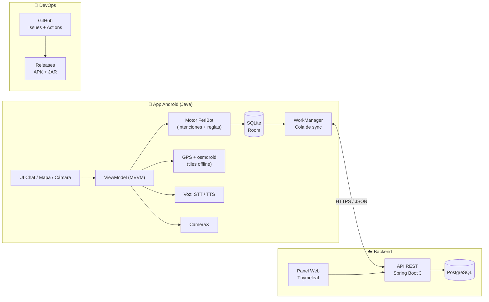
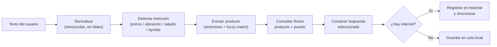

# 02 · Arquitectura

## 1. Vista general

Arquitectura **cliente-servidor híbrida con enfoque offline-first**: la app móvil siempre
responde desde su base local; la nube solo enriquece y sincroniza.



## 2. Componentes

### 2.1 App móvil (Java 17, Android Studio)

| Capa | Responsabilidad |
|---|---|
| `ui/` | Activities/Fragments, chat, mapa, cámara, historial |
| `viewmodel/` | Estado de pantalla y orquestación |
| `domain/` | Modelos, casos de uso, motor de intenciones |
| `data/local/` | Room: entidades, DAOs, base de datos, seed |
| `data/remote/` | Retrofit, DTOs, API |
| `data/sync/` | Worker de sincronización y cola de cambios |
| `util/` | Formateo de moneda, permisos, constantes |

Patrón **MVVM + Repository**. Sin lógica de negocio en las Activities.

### 2.2 Motor FeriBot (local, sin IA en la nube)

Pipeline de 4 pasos:



Reglas clave:

- Normalización de modismos: `lap → laptop`, `cel → celular`, `chamarra → chamarra/casaca`.
- Puntaje de coincidencia: exacto (100) > sinónimo (90) > contiene (70) > Levenshtein ≤ 2 (50).
- Si no hay coincidencia: se responde con el rubro más cercano y se aclara que es estimado.
- Toda respuesta se arma con una plantilla fija (producto, precio, ubicación, acción, consejo).

### 2.3 Backend (Spring Boot 3 + PostgreSQL)

| Endpoint | Método | Descripción |
|---|---|---|
| `/api/v1/auth/login` | POST | JWT para administradores |
| `/api/v1/productos` | GET/POST/PUT/DELETE | Catálogo |
| `/api/v1/puestos` | GET/POST/PUT/DELETE | Puestos y coordenadas |
| `/api/v1/sync/pull` | GET | Cambios desde una marca de tiempo |
| `/api/v1/sync/push` | POST | Lote de cambios locales |
| `/api/v1/historial` | POST | Telemetría anónima de consultas |

El panel web consume la misma API. En el MVP se sirve con Thymeleaf para reducir despliegues.

### 2.4 Sincronización híbrida

1. Cada cambio local se registra en `cola_sincronizacion` (`entidad`, `entidad_id`, `operacion`, `payload`).
2. `SyncWorker` (WorkManager) se ejecuta con red disponible y cada 6 h.
3. `push`: envía el lote; el servidor responde con conflictos.
4. `pull`: descarga cambios con `actualizado_en > última_sincronización`.
5. Resolución de conflictos: **last-write-wins** por `actualizado_en`; los conflictos se registran.
6. Un cambio local pendiente nunca se sobrescribe: se marca para revisión.

## 3. Decisiones de arquitectura (ADR)

| ID | Decisión | Alternativa descartada | Motivo |
|---|---|---|---|
| ADR-01 | Java nativo en Android | Kotlin / Flutter | Requisito académico y dominio del equipo |
| ADR-02 | Room (SQLite) | Realm / archivos JSON | Integración oficial, consultas SQL y migraciones |
| ADR-03 | osmdroid + tiles offline | Google Maps | Google no permite descarga offline arbitraria |
| ADR-04 | Motor de reglas local | LLM en la nube | Funciona sin señal y responde rápido |
| ADR-05 | Spring Boot | Node/Express | Mismo lenguaje en todo el stack |
| ADR-06 | Thymeleaf para el panel | React SPA | Menos piezas que desplegar en el MVP |
| ADR-07 | Cola de sync propia | Firebase Firestore | Control total y sin dependencia de costos |

## 4. Requisitos no funcionales

| Categoría | Requisito |
|---|---|
| Rendimiento | Respuesta local ≤ 1 s; arranque en frío ≤ 3 s |
| Disponibilidad | 100 % de funciones de consulta sin internet |
| Almacenamiento | Dataset + tiles ≤ 150 MB |
| Seguridad | HTTPS, JWT, contraseñas con BCrypt, sin datos personales en logs |
| Usabilidad | Textos ≥ 16 sp, contraste AA, navegación por voz |
| Compatibilidad | Android 8.0 (API 26) a Android 16 (API 36) |
| Mantenibilidad | Capas separadas, pruebas unitarias del motor ≥ 70 % |

## 5. Estructura del paquete Android (prevista)

```
bo.edu.feriabot
├── ui/chat        ChatActivity, ChatAdapter
├── ui/mapa        MapaActivity
├── ui/camara      CamaraActivity
├── ui/historial   HistorialActivity
├── viewmodel/     ChatViewModel
├── domain/        Producto, Puesto, MotorFeriBot, RespuestaFeriBot
├── data/local/    AppDatabase, ProductoDao, PuestoDao, entidades
├── data/remote/   ApiService, DTOs
├── data/repository/
├── data/sync/     SyncWorker
└── util/          FormatoMoneda, Normalizador
```
