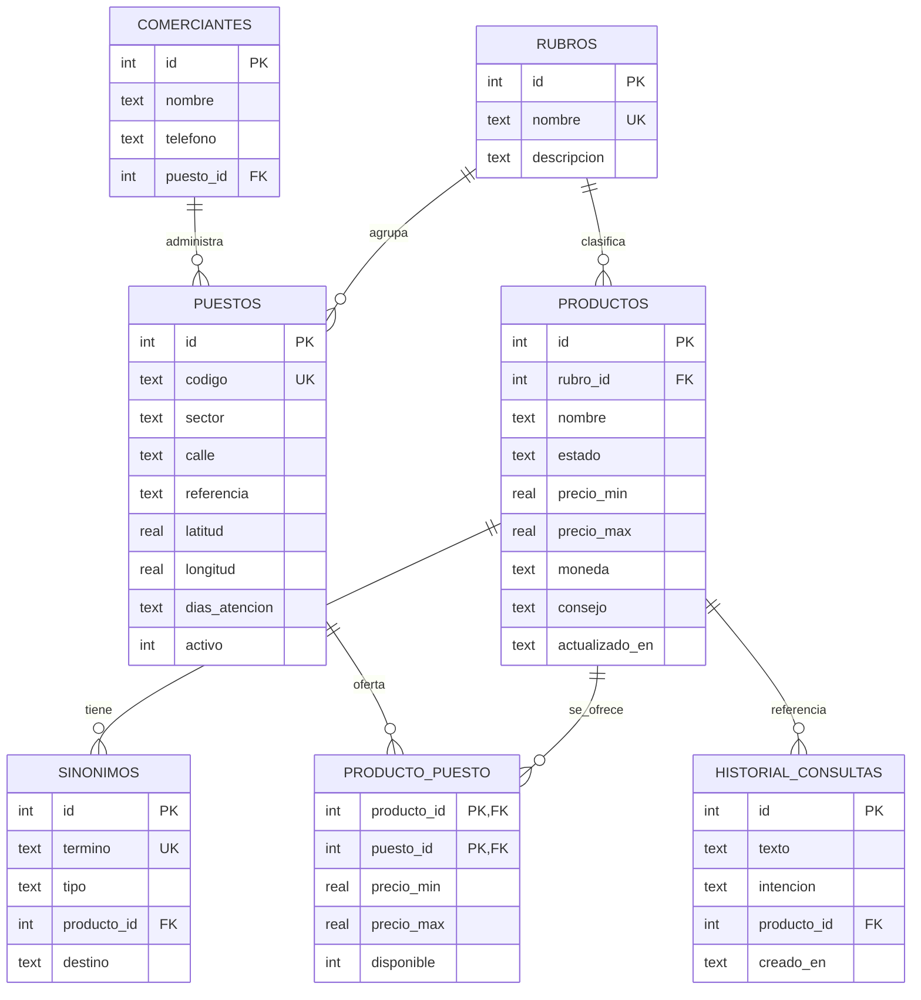

# 03 · Modelo de datos

## 1. Diagrama entidad-relación



## 2. Diccionario de datos

### `rubros`
| Campo | Tipo | Restricción | Descripción |
|---|---|---|---|
| id | INTEGER | PK | Identificador |
| nombre | TEXT | NOT NULL, UNIQUE | Electrónica, Ropa, etc. |
| descripcion | TEXT | — | Detalle del rubro |

### `productos`
| Campo | Tipo | Restricción | Descripción |
|---|---|---|---|
| id | INTEGER | PK | Identificador |
| rubro_id | INTEGER | FK → rubros | Clasificación |
| nombre | TEXT | NOT NULL | Nombre canónico |
| estado | TEXT | nuevo / usado / reacondicionado | Condición |
| precio_min | REAL | ≥ 0 | Límite inferior BOB |
| precio_max | REAL | ≥ precio_min | Límite superior BOB |
| moneda | TEXT | default `BOB` | Moneda |
| descripcion | TEXT | — | Detalle breve |
| consejo | TEXT | — | Tip de verificación |
| activo | INTEGER | 0/1 | Visible en la app |
| actualizado_en | TEXT | ISO-8601 | Base de sincronización |

### `puestos`
| Campo | Tipo | Restricción | Descripción |
|---|---|---|---|
| id | INTEGER | PK | Identificador |
| codigo | TEXT | UNIQUE | Ej. `ELE-01` |
| sector | TEXT | NOT NULL | Electrónica, Autopartes… |
| calle | TEXT | — | Calle o avenida |
| referencia | TEXT | — | Referencia humana |
| latitud / longitud | REAL | — | Coordenadas GPS |
| dias_atencion | TEXT | CSV | `jueves,domingo` |
| horario | TEXT | — | `08:00-17:00` |
| activo | INTEGER | 0/1 | Vigente |

### `comerciantes`
| Campo | Tipo | Restricción | Descripción |
|---|---|---|---|
| id | INTEGER | PK | Identificador |
| nombre | TEXT | NOT NULL | Nombre o razón social |
| telefono | TEXT | — | Contacto |
| puesto_id | INTEGER | FK → puestos | Puesto principal |

### `producto_puesto`
Precio y disponibilidad **por puesto**, porque un mismo producto varía de un casero a otro.

| Campo | Tipo | Restricción |
|---|---|---|
| producto_id | INTEGER | PK, FK → productos |
| puesto_id | INTEGER | PK, FK → puestos |
| precio_min / precio_max | REAL | ≥ 0 |
| disponible | INTEGER | 0/1 |

### `sinonimos`
Resuelve modismos y variantes del habla boliviana.

| Campo | Tipo | Restricción | Descripción |
|---|---|---|---|
| id | INTEGER | PK | Identificador |
| termino | TEXT | UNIQUE | `lap`, `chamarra`, `a cómo está` |
| tipo | TEXT | producto / intencion / modismo | Categoría |
| producto_id | INTEGER | FK nullable | Si es tipo `producto` |
| destino | TEXT | nullable | Intención destino o término canónico |

### `historial_consultas`
| Campo | Tipo | Descripción |
|---|---|---|
| id | INTEGER | PK |
| texto | TEXT | Consulta original |
| intencion | TEXT | precio / ubicacion / saludo / ayuda / desconocida |
| producto_id | INTEGER | Producto detectado (nullable) |
| respuesta | TEXT | Respuesta generada |
| origen | TEXT | local / nube |
| creado_en | TEXT | ISO-8601 |

### `cola_sincronizacion`
| Campo | Tipo | Descripción |
|---|---|---|
| id | INTEGER | PK |
| entidad | TEXT | productos / puestos / historial |
| entidad_id | INTEGER | Registro afectado |
| operacion | TEXT | INSERT / UPDATE / DELETE |
| payload | TEXT | JSON del cambio |
| estado | TEXT | pendiente / enviado / error |
| intentos | INTEGER | Reintentos |
| creado_en / enviado_en | TEXT | Marcas de tiempo |

## 3. Relaciones principales

- Un **rubro** agrupa muchos **productos** y muchos **puestos**.
- Un **producto** se ofrece en varios **puestos** (N:M vía `producto_puesto`).
- Un **comerciante** administra un **puesto**.
- Un **sinónimo** puede apuntar a un producto o a una intención.
- El **historial** referencia el producto detectado, si existe.

## 4. Índices

```sql
CREATE INDEX idx_productos_rubro   ON productos(rubro_id);
CREATE INDEX idx_productos_nombre  ON productos(nombre);
CREATE INDEX idx_puestos_sector    ON puestos(sector);
CREATE INDEX idx_pp_puesto         ON producto_puesto(puesto_id);
CREATE INDEX idx_historial_fecha   ON historial_consultas(creado_en);
CREATE INDEX idx_cola_estado       ON cola_sincronizacion(estado);
```

## 5. Estrategia de datos

| Aspecto | Decisión |
|---|---|
| Origen | `database/dataset/productos.json` (editable, versionado) |
| Generación | `tools/generar-seed.ps1` produce `database/seed.sql` |
| Carga local | Room `createFromAsset("feribot.db")` o `RoomDatabase.Callback` |
| Versionado | Campo `dataset_version` en tabla `metadata` |
| Sync | `actualizado_en` + cola local; conflicto *last-write-wins* |
| Privacidad | Historial sin datos personales; teléfonos solo de comerciantes |

## 6. Compatibilidad Room

El esquema de `schema.sql` es la **referencia**. Las entidades Room deben:

- Usar `@PrimaryKey(autoGenerate = true)` en `id`.
- Declarar `@ForeignKey` con `onDelete = CASCADE` donde corresponda.
- Mantener los nombres de columna con `@ColumnInfo(name = "...")`.
- Versionar la base (`@Database(version = N)`) y proveer migraciones explícitas.
